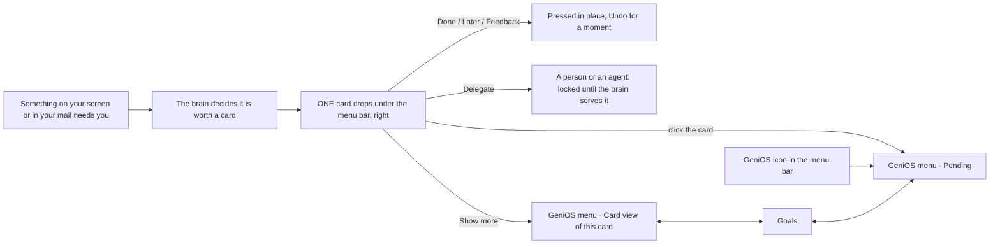

# 07.2 · GeniOS desktop — how we built it, what it looks like, how it connects

**Written for:**
- **Harsh and every coding agent** who wires this design into the real app (`Extension/` in the dashboard repo);
- **Rohit**, as the record of what was agreed.

**Status, 22 Oct 2026:**
- This is a **dummy**, agreed screen by screen with Rohit.
- No GeniOS code was changed for it.
- The whole code is in [`01-CODEBASE.md`](01-CODEBASE.md), commented out so it cannot run from there.
- The live dummy is `~/Downloads/Artifacts/Product/genios-desktop-dummy`, outside every repo.

---

## 0 · In one paragraph

GeniOS stops showing ten or fifteen cards at once. When it reads something on your screen or in your mail that needs you, **one card drops from the menu bar on the right**, like a phone notification. The card says:
- where it came from;
- what to do;
- why, in a line or two;
- which goal it moves.

It also carries the four buttons **Done · Delegate · Later · Feedback**.

**Show more** opens the **GeniOS menu** under its icon in the menu bar, with three views:
- **Card**: the same card, with why it came up and the approach, goal and importance;
- **Goals**: your active goals, numbered, each with its own count of what you did and what came back, and the cards that move it;
- **Pending**: everything left today, screen and tools together, numbered, most pressing first.

The account sits in the menu's corner.

The look:
- black and white first, with a touch of dark green and golden yellow;
- Inter, regular everywhere; a heading sits just above medium;
- nothing is bold.

---

## 1 · Where everything is

| What | Where |
|---|---|
| The dummy (runs) | `~/Downloads/Artifacts/Product/genios-desktop-dummy` — `npm install`, then `npm run brain` and `npm run dev` |
| The drop and the menu | http://localhost:5199/stage.html — Drop 1 / 2 / 3 at the bottom left; **All side by side** at `?board=1` |
| The panel (⌘⇧G): Today, an opened card, This week, History | http://localhost:5199/desktop.html — states with `?s=setup`, `?s=empty`, `?s=offline`, `?s=signedout` |
| The popups as they are drawn today | http://localhost:5199/lane.html?toast=advice — also `urgent`, `reminder`, `proposal`, `brief` |
| The whole code, commented out | [`01-CODEBASE.md`](01-CODEBASE.md): 49 files, 8,364 lines; a restore script at its top (checked: every file comes back identical) |
| The analysis it started from, with before/after screenshots | https://claude.ai/artifact/Gq5t86s8fxpn8hPzZYTjR8 |
| An earlier rebuild of the panel in real code (not merged) | dashboard repo, branch `rohit/desktop-ux`. It holds reusable pieces: the press that sends `surface: "desktop"` and never swallows a refusal; the web card reader used from the app; the Rust placement fixes (the panel on the pointer's screen; a popup never on top of the panel); a render check. Its look is replaced by this dummy. |
| The app icon | [`assets/genios-icon-512.png`](assets/genios-icon-512.png) (+ `favicon-32.png`, `favicon-64.png`, `apple-touch-icon.png`, `favicon.ico`, and the logo it was cut from, `genios-logo.png`): the white G of the GeniOS wordmark on the logo's own black sky and green horizon |
| Screenshots of every screen | [`screens/`](screens/) — see §3.5 |

---

## 2 · What Rohit asked, round by round (22 Oct)

| # | Rohit said (short) | What changed |
|---|---|---|
| 1 | Analyse the Mac app in detail. | An audit, with screenshots of every screen. It found 8 faults in what cards say and do, 7 in the layout, 4 in the look and 2 in the window. Example: ": undefined" on expert cards; "Not useful" refused by the server and the card coming back; no answer box on a question card. |
| 2 | First a **dummy**; real files only when I say. Nothing in GeniOS until then. | The dummy moved to its own folder, outside every repo. |
| 3 | Inter only. No bold, except the subject line. Light theme. **About 40% smaller.** Use the four buttons of the web Cards page (06-CARDS). | Inter everywhere; the subject heavier than the rest. The panel drawn at 85% in a window about 40% smaller (330 × 456). Done · Delegate ▾ · Later ▾ · Feedback ▾ as on the web. |
| 4 | Not 10–15 cards at once. **One piece of intelligence at a time**, dropping on the right like a phone notification (his reference: a black island under the menu bar). Click it for today's cards. Show more opens the **menu bar**. Screen and tool cards **together, with tags**. A heading that is the call to action, one or two lines of what and why, the source, scenario, importance and approach, the effect on the goal. The menu: **Card · Goals · Pending**. *"Teen cards aur teen menu bars."* | The drop (three samples), and the menu with its three views. |
| 5 | Put the **four buttons on the drop**. In the menu, the **same card** as the drop. The quote was unclear. Goals: more readable counts, a number system; "2 cards for this goal" must open both. A **×** on cards. Header: × on the left; Card · Goals · Pending and the **account** on the right. Dark green, golden yellow, whitish. | The buttons open inside the card. The menu reuses the card. "Why it came up" was added. Goals are numbered, with a count strip; the cards list opens. The header changed. |
| 6 | **Black, dark green, white.** More white and black, less green. Luxury, professional. | Black card, white menu; green only as a touch. |
| 7 | A **touch** of dark green and golden yellow back. Approach, goal and importance as **one-liners**. Show the count better. Settings: the **device code** and the **API / connect** options. The heading a little heavier than medium. **"screen", not "your screen"**. Keep this size ratio in the real app. | Gold accents; a funnel with bars and percents; account sections; heading weight 560; the tag wording changed. |
| 8 | Approach, goal and importance as **three lines**, **no icons**. Behind the menu's content, the **dark theme**; the cards on it white. | Three plain rows; the menu ground dark with white cards on it. |
| 9 | The favicon from the GeniOS logo. This folder, with the code and this file. | The icon set and the two files. |

---

## 3 · The product, as designed

### 3.1 The flow



### 3.2 The drop: one card at a time

```
┌──────────────────────────────────────────────────────────────┐ ← attached under the menu bar
│ [icon]  WhatsApp · screen   Follow-up   ● High            ✕  │
│ just now                                                     │
│         Send Neha the investor deck            ← the call to action
│         You told her you'd send it by Friday. She leads      │
│         Monday's term-sheet call and needs it before then.   │ ← what and why, 1–2 lines
│         ◎ Close the seed round · Keeps the lead investor warm│ ← the goal it moves
│         [Done] [Delegate] [Later] [Feedback]    Show more ›  │
└──────────────────────────────────────────────────────────────┘
```

**Parts:**
- an icon for the kind, with the time under it;
- **tags**:
  - the source and how it came ("WhatsApp · screen", "Gmail · mail thread");
  - the kind (Follow-up · Deadline · Decision · Ask · Question · Waiting);
  - the importance, as a gold dot and a word (Now · High; nothing when it is normal);
- the **subject**, written as an action;
- **why**, in one or two lines;
- the **goal** it moves, and how;
- the four buttons and **Show more ›**;
- a **✕** to dismiss it.

**The buttons open inside the card:**
- **Later**: "Bring it back" — In 4 hours · Tomorrow, 9:00 · In 3 days · Pick a day.
- **Delegate**: A person · An agent, each with a list. Hand over / Ask it is locked, and one line says it "goes live with the next brain update".
- **Feedback**: "What is off?" offers the card's own reasons; a box takes your words; then **Send**.
- **After a press**: one line, e.g. "Marked done · Undo".

**The three samples:**
1. A WhatsApp follow-up: Send Neha the investor deck.
2. A deadline on a website: Submit the DPIIT application today.
3. A Gmail decision: Confirm Thursday 4 pm with Ananya.

### 3.3 The GeniOS menu

**Header:**
- **✕** on the left;
- **Card · Goals 3 · Pending 6** on the right (the open one a white pill);
- the **account** circle (R) in the far corner.

**The ground:** black with a faint green glow. **The cards on it:** white.

#### Card

1. **The same card as the drop**, dark, with its four buttons and ✕.
2. **Why it came up** (white). Three things, so nobody has to guess what the quote is:
   - **where it was read**: "On your screen · WhatsApp · chat with Neha Kapoor · Tue, 6:40 pm";
   - **the words**, with who said them: *You wrote* "Will send the deck by Friday";
   - **what GeniOS took it to be**: "Your promise, due Fri 24 Oct. Nothing has gone to Neha since."
3. **Three lines, no icons:**
   - **Approach**: Reply in the chat with the deck link
   - **Goal**: Close the seed round
   - **Importance**: This week

#### Goals

Numbered 1, 2, 3. Each goal is a white card with:
- the number, the name, and "62% done · by 30 Nov";
- the status as a dot and a word (On track · At risk · Behind);
- a progress bar;
- what is happening, in one line;
- **the count, as a funnel**. Each step is a row: the number, what it counts, a gold bar for its share of the first step, and the percent:
  - Close the seed round: **14** investors reached → **6** replied (43%) → **3** met you (21%);
  - Convert the Evokoa pilot to paid: **6** mails to Evokoa → **2** replies (33%) → **1** meeting held (17%);
  - Get DPIIT recognition: **4** of 6 sections filled (67%) → **0** of 1 certificate uploaded (0%) → **1** day left;
- **the same numbers as one sentence**, e.g. "Of the 14 investors you wrote to, 6 replied and 3 took a meeting.";
- **"2 cards for this goal ▾"**, which opens the numbered list of those cards. Each opens in the Card view.

#### Pending

Every open thing today: screen items and tool cards together, the tags telling them apart.
- Numbered 1–6, most pressing first: Now, then High, then the rest.
- Each row: tags, then the subject with its time, then why (two lines at most), then the goal.
- A click opens it in the Card view.

#### Account (the R in the corner)

- **Who:** Rohit · email · Owner · workspace.
- **This Mac:**
  - "Signed in with a device code";
  - **New code** shows a code (`KQ7D-M3XW`) to type at brain.thegenios.com/device and link another device.
- **Screen reading:**
  - "Reading · WhatsApp", with Pause / Resume;
  - Accessibility and seat status;
  - **Silence popups** on/off.
- **Connected tools:**
  - Gmail ● and Calendar ● connected;
  - Slack · connect.
- **Server & API:**
  - the server (api.thegenios.com) and its status;
  - **Change** shows the server address and an API key field.
- **Foot:** Open GeniOS on the web · Sign out.

### 3.5 The screens

All are in [`screens/`](screens/): the dummy at its real size (Retina, 2×), with sample data.

| File | What it shows |
|---|---|
| [`01-desktop-with-drop.png`](screens/01-desktop-with-drop.png) | The whole desktop: the WhatsApp line GeniOS read (outlined), and the drop under the menu bar |
| [`02-drop-follow-up.png`](screens/02-drop-follow-up.png) | Drop 1: a WhatsApp follow-up, High |
| [`03-drop-deadline.png`](screens/03-drop-deadline.png) | Drop 2: a deadline on a website, Now |
| [`04-drop-decision.png`](screens/04-drop-decision.png) | Drop 3: a Gmail decision, High |
| [`05-drop-later.png`](screens/05-drop-later.png) | Later, open inside the drop: Bring it back |
| [`06-drop-delegate.png`](screens/06-drop-delegate.png) | Delegate, open inside the drop: A person · An agent, locked |
| [`07-drop-feedback.png`](screens/07-drop-feedback.png) | Feedback, open inside the drop: What is off? and your words |
| [`08-menu-card.png`](screens/08-menu-card.png) | The menu's Card: the same card, Why it came up, Approach · Goal · Importance |
| [`09-menu-goals.png`](screens/09-menu-goals.png) | Goals: numbered, the funnel, and "2 cards for this goal" open |
| [`10-menu-pending.png`](screens/10-menu-pending.png) | Pending: numbered, Now → High → the rest |
| [`11-menu-account.png`](screens/11-menu-account.png) | The account, with a new device code shown |
| [`12-all-side-by-side.png`](screens/12-all-side-by-side.png) | The three drops and the menu's three views together |

### 3.4 The panel (⌘⇧G)

The full view stays, on the same parts and theme (`src/desktop`):
- **Top bar:** the views; a menu (Refresh, Pause, Only what's on my screen, Open on the web, Sign out behind a confirm).
- **Today:** grouped Decide · Answer · On your screen · Waiting, with a summary line.
- **An opened card** on its own page: recommendation → what · why · how → what it gets you (goal, deadline) → the source, then Show more.
- **This week:** rings and percents.
- **History:** by day.
- **First run:** one setup card.
- **The foot:** a reading bar.

Where it differs from the drop and the menu, **the drop and the menu win**: they are the later rounds.

---

## 4 · Look and theme

### 4.1 Colours

The stage's tokens are in `src/stage/stage.css` (`body.stage`); the panel's are in `src/desktop/theme.css`.

| Token | Value | Used for |
|---|---|---|
| Card ground | `#0a0a0b` → `#131514` (a gradient) | the drop; the card in the menu; the menu's ground; the funnel strip |
| Green glow | `rgba(29, 90, 62, 0.38–0.55)` radial, bottom-right | depth on the dark ground; a touch only |
| Gold sheen | `rgba(217, 178, 76, 0.08–0.13)` radial, top-left | a touch only |
| Text on dark | `#f7f7f5`; secondary 68%; tertiary 46% | everything written on black |
| Gold | `#d9b24c` (on dark) · `#b8902a` (deep) | the importance dot; the goal icon; an open button; a chosen option; the account letter and ring; the bar under "You wrote"; the funnel bars and percents |
| Dark green | `#1d5a3e` · `#2f7a55` · `#3f8f68` | progress bars; "connected" dots; accent words on white (At risk, the goal under a Pending row) |
| White | `#ffffff`; inset `#f5f5f4` | the menu's cards, the panel, insets |
| Ink | `#0b0b0c` / `#2a2b2c`; grey `#6b6c6e`; lines 8% and 14% black | all text on white |
| Desktop backdrop | stone `#dcdcd8` → `#c4c5c0` | **dummy only**: it stands in for the person's own wallpaper |

**Rules:**
- Black and white carry the design.
- Green and gold are touches, never fills of a whole block, except the dark grounds above.
- No red, orange or blue anywhere.

### 4.2 Type

- **Inter Variable** (`@fontsource-variable/inter`, bundled — the app's CSP allows only `font-src 'self' data:`).
- **400 everywhere.** A **heading at 560**, just above Medium: the card subject, the menu's subject lines, the goal names. Nothing heavier.

| Text | Size |
|---|---|
| The drop's subject | 17px |
| The drop's why | 13.5px |
| Tags, times, small notes | 12px |
| Buttons | 12.5px |
| The menu's card subject | 17px (`.dx-title`) |
| Pending and goal subjects | 14–14.5px |
| Labels (WHY IT CAME UP, APPROACH…) | 12px, upper case, tracked 0.08em |
| Funnel numbers | 19px |

### 4.3 Size and the ratio rule

- The whole page is drawn at **85%** (`html { zoom: 0.85 }`).
- On screen that gives:
  - the drop: 480 CSS px → about **408 px** wide;
  - the menu: 440 → about **374 px**;
  - the panel: 388 × 536 → **330 × 456**.
- **Rohit: keep this ratio in the real app.** Windows and fonts must match what the dummy shows; do not scale them up.

### 4.4 Shapes

| What | Shape |
|---|---|
| Drop | corners 6 · 6 · 26 · 26 (it hangs from the menu bar) |
| The card inside the menu | 18 |
| Cards | 14 |
| Buttons | 9 |
| Tags | 6 |
| Shadows | deep under the drop and the menu; soft under white cards; a hairline (1px white at 6–10%) where dark meets dark |

### 4.5 Words

| What | Rule |
|---|---|
| Tags | "Gmail · mail thread", "WhatsApp · screen" (never "your screen") |
| Importance | Now (today) · High (this week); nothing when normal |
| Approach, Goal, Importance | no icons in front |
| Buttons | Done · Delegate · Later · Feedback; Answer on a question |
| A refusal | one sentence, the web's own words (`refusals.ts`) |

---

## 5 · The data: every field, and where it comes from

The drop and the menu draw one shape, **`DeskItem`** (`src/stage/sample.ts`). In the app it is built by **`src/stage/live.ts`**:
- `cardItem(card)` from a brain card, read through the web's reader;
- `followupItem(f)` from a screen follow-up;
- `pendingItems(...)` for both, sorted.

The dummy draws sample items in the same shape.

| Field | Shown as | From a brain card (`/cards/{id}` → `readCard` / `ownCard`) | From a screen follow-up (`followups_open`) | Live today? |
|---|---|---|---|---|
| `source` | "Gmail · mail thread" | `tools[0]` (tool + how) | the app or site it was seen in (`screenApp`), "screen" | yes |
| `kind` | Decision · Question · Waiting … | the lane (decision / conflict / question / waiting) | the follow-up kind (ask, my_promise, deadline …) | yes |
| `importance` | ● Now / ● High | urgency band: critical → Now, high → High | due date: late → Now, within 3 days → High | yes |
| `subject` | the call to action | `headline` (tidied by the reader) | the follow-up's text | yes; **clearer subjects need brain C1** |
| `why` | 1–2 lines | `whyNow`, else the description; on a question, why it is asked | "You said you would / X is waiting", plus the due date | yes |
| `approach` | the Approach line | `how` (first step), else the move | "Do it, then mark it done" / "Reply where it was asked" | partly; **written per card with C1** |
| `goal` | the goal line and the Goal line | — | — | **no: the brain links no card to a goal (C1/C8)**. Until it does, the line reads "Not linked yet". |
| `quote` | Why it came up | the first quoted mail line, its sender and date | the words on screen, who and when | partly; **the sender and date of every quote is brain C4** |
| `when` | "just now", "2 min ago" | the card's age | when it was read | yes |
| `primary` | the main button | Answer on a question; else Done | Done | yes |

**Goals (the Goals view):**
- The brain serves **accepted goal lines** today (`/v1/company-brief`). The web Goals page reads them in `src/product/internal/dashboard/goals/live.ts`.
- Not served yet:
  - progress;
  - due date;
  - status;
  - the funnel counts (reached → replied → met);
  - which cards move a goal.
- Those wait for **`GET /v1/goals`** (GeniOS-009 G1/G4/G5). Until then the Goals view should show the goal lines with "not set yet". It must never show sample numbers as real.

---

## 6 · How it connects: wiring it into the real app

The app is the Tauri project `Extension/` in the dashboard repo. Two windows already exist:
- **`lane`**: a transparent popup window, never focused, top-right;
- **`main`**: the panel.

### 6.1 Windows

| Design part | Window | What to change |
|---|---|---|
| The drop | `lane` (`src-tauri/src/lane/mod.rs`, `src/lane/Lane.tsx`) | Render `Drop` instead of today's toast. Width: 480 CSS px × 0.85 + 16 padding ≈ **420 px**. Height: it already reports its own (`lane_resize`). Keep it never focused and one at a time; the Rust queue, quiet hours and rate limits stay as they are. |
| The menu | `main` (`tauri.conf.json`, `src/desktop/main.tsx`) | Render `MenuPanel`. Width 440 × 0.85 ≈ **374 px**, height up to about 600. Open it **under the tray icon**: take the click's position from `TrayIconEvent::Click`, instead of the fixed top-right. ⌘⇧G toggles the same window. Esc closes it. |
| Show more | drop → menu | The drop sends an event (e.g. `genios://open`, `{ view: "card", id }`). Rust shows `main`, and the menu opens that item in the Card view. A click on the drop's body opens Pending. |
| Placement | both | Take `panel_position` and `lane_position` from branch `rohit/desktop-ux`. They place the window on the screen the pointer is on, under the menu bar, and keep the drop beside the menu, never on top of it. |
| Icon | bundle | `npx tauri icon public/genios-icon-512.png` writes every app and tray size. |

### 6.2 Data

| The menu shows | Read with | Already exists? |
|---|---|---|
| Pending, and each Card | `cards.ts` (`loadQueue`, `fillDetails`, `readOpen` → the web's `card-read.ts`) + `followups_open`, through `live.ts` `pendingItems` | yes, in the dummy's `src/desktop` and on branch `rohit/desktop-ux` |
| The drop's item | today the lane sends `{ id, style, kind, capability_id, priority, headline, body, actions, lines }` | **needs one more field**: the card or follow-up id, so the drop can draw the full `DeskItem` (source, kind, why, goal). Either the Rust `Toast` carries it, or the drop looks the item up. |
| Goals | `/v1/company-brief` today; `GET /v1/goals` later | goal lines yes; progress and counts no |
| Account | `auth_state` (who), `capture_status` (reading), the website's Integrations page (tools) | mostly; see 6.4 |

### 6.3 What each button sends

Every card press goes through `pressCard` (`src/desktop/api.ts`). It posts `/cards/{id}/action` with `surface: "desktop"`, and **throws** the server's refusal code. The panel says the refusal in one sentence (`refusals.ts`) and never drops the card.

| Button | A brain card | A screen item |
|---|---|---|
| Done | `do_it_myself` (Undo for 5 s before it is sent) | `followup_done` |
| Later | `snooze` with the card's own option (`4h`, `tomorrow_09`, `3d`), or `custom` + `custom_until` for a picked day | `followup_snooze` (`1h`, `tonight`, `tomorrow`) |
| Feedback | `wrong` with one of the card's own reasons, your words, and how far they apply (`file` · `kind` · `company`) | `recent_feedback` (`not_useful`) on the popup it came from |
| Answer (questions) | `answer` with your words; the card stays, versioned | — |
| Delegate | **locked**: the brain has no hand-over route (06-CARDS C5) | locked |
| Already handled | — | `followup_done` with `handled: true` |

### 6.4 The account's settings

| Setting | Command or route | Exists? |
|---|---|---|
| Who is signed in | `auth_state` → email, seat | yes |
| Device code (link another device) | `auth_start` → `user_code`, `verification_uri`; `auth_poll_status` | yes (today's sign-in uses it) |
| Pause / Resume reading | `capture_pause(minutes)` / `capture_resume`; state from `capture_status` | yes |
| Accessibility | `capture_open_accessibility_settings` | yes |
| Silence popups | only the tray's check item today (`Silence` in `lib.rs`) | **add a command** (e.g. `lane_set_silence(on)`) so the menu can switch it |
| Connected tools | the website's **Integrations** page (`/dashboard/integrations`) via `open_dashboard`; a read of which tools are connected | open yes; **a read for the list is to add** |
| Server address | `rememberBaseUrl` / `defaultBaseUrl` (today under sign-in's Advanced) | yes |
| API key | — | **not supported by the app today** (device sign-in only). Decide before showing it. |
| Open on the web / Sign out | `open_dashboard("/dashboard/cards")` / `sign_out` (behind a confirm) | yes |

### 6.5 The theme in the app

1. Copy the tokens into `Extension/src/desktop/theme.css`:
   - the dark ground;
   - the green and gold touches;
   - the white and ink tokens;
   - Inter Variable at 400 and 560;
   - `zoom: 0.85`.
2. Add `@fontsource-variable/inter` to `Extension/package.json`. It is bundled, so the CSP needs no change.
3. Light only. The panel's dark block is gone in the dummy.

---

## 7 · What the brain must add, and why

| # | Change | Why the design needs it |
|---|---|---|
| 1 | **`GET /v1/goals`**: each goal's progress, due date, status, its funnel counts (what was done → what came back), and its cards | The Goals view, and the goal line on every card (GeniOS-009 G1/G4/G5) |
| 2 | **Card ↔ goal link** | "◎ Close the seed round · keeps the lead investor warm" on the drop (06-CARDS C1/C8) |
| 3 | **The lane carries the item's id** (card or follow-up) | The drop can draw the full card: source, kind, why, goal |
| 4 | **Clear subject, approach and why, written per card** | The call to action and the one-liners (06-CARDS C1) |
| 5 | **Each quote with its sender and date** | "Why it came up" says who wrote what, when (06-CARDS C4) |
| 6 | **A delegate route** | Delegate to a person or an agent, unlocked (06-CARDS C5) |
| 7 | A Rust command for Silence popups | The switch in the account |

---

## 8 · The order to build it (for Harsh)

1. **Theme first.** Tokens, Inter Variable, zoom 0.85, light only, in `Extension/src/desktop/theme.css`; the app icon from `genios-icon-512.png`. *Check:* `npm run build`; open the app; text and windows at the dummy's sizes.
2. **The data reader.** Bring `cards.ts`, `api.ts` (`pressCard`), `refusals.ts` and the web's `card-read.ts` import over from `rohit/desktop-ux`. Add `src/stage/live.ts`. *Check:* Pending shows the live cards and screen items, numbered, Now → High → rest.
3. **The menu in `main`.** `MenuPanel` (Card · Goals · Pending · Account); open under the tray icon; ⌘⇧G and Esc. *Check:* each tab with live data. Goals shows goal lines with "not set yet" until brain #1.
4. **The drop in `lane`.** `Drop` with the four buttons. Rust sends the item id (brain/Rust #3). Show more opens the menu on that card. *Check:* one drop at a time; quiet hours still hold; a press lands (`surface: desktop`); Undo works; a refusal shows its sentence.
5. **Account settings.** Wire the commands in 6.4; add the Silence command.
6. **Placement.** Take `panel_position` and `lane_position` from `rohit/desktop-ux`. *Check:* `cargo test` (254 tests on that branch).
7. **Brain #1–#6** as they land. Each one turns a placeholder into the real thing; no screen change is needed.

---

## 9 · How the dummy was checked

**Done:**
- `tsc --noEmit` is clean.
- Every round was looked at in Chromium, at the dummy's real size:
  - the drop and each of its inline panels;
  - the menu's three views and the account;
  - the panel's screens and the popups.
- `01-CODEBASE.md` was restored into an empty folder: **49 of 49 files identical** to the dummy.

**Not done, because it is a dummy:**
- real data;
- the Tauri windows;
- checks for the drop and the menu. The panel's render check (16 checks) lives on `rohit/desktop-ux`.

---

## 10 · The rules this design keeps

1. **One thing at a time.** Intelligence drops when it is needed; nobody gets 10–15 cards at once.
2. **Screen and tools together.** Tags tell them apart; there are no separate lists.
3. **Short:**
   - a heading that is the call to action;
   - one or two lines of what and why;
   - one line each for approach, goal and importance.
4. **Every card says where it came from**, and the quote says who wrote it, where and when.
5. **Black and white first.** Dark green and golden yellow as touches. Luxury, professional.
6. **Inter, 400; headings at 560.** Nothing bold. No icons in front of Approach, Goal and Importance. "screen", not "your screen".
7. **The dummy's size ratio is the app's.**
8. **The dummy first.** Real files change only when Rohit says so.
